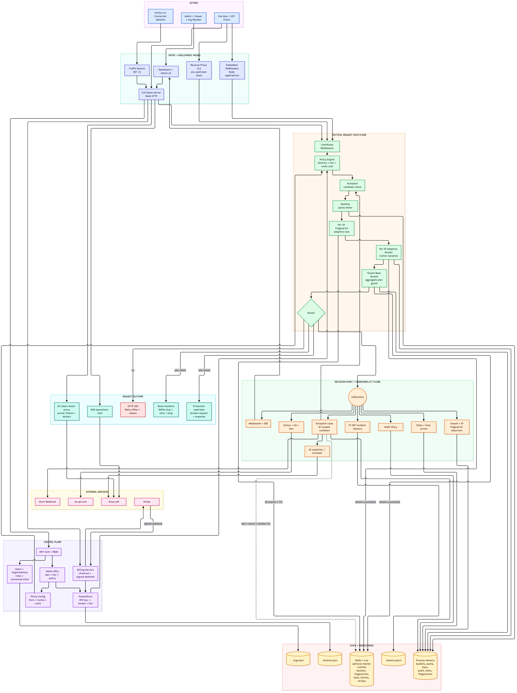

## Learning objectives

After this block, you should be able to explain:

1. Why an in-memory ban does not survive a restart or work across replicas.
2. Why IP reputation must expire instead of becoming a permanent blacklist.
3. How HMAC protects raw IPs in Redis keys.
4. How Redis TTLs represent bans, fingerprints, storms, strikes, and idle buckets.
5. Why Lua makes one bucket or storm transition atomic.
6. Why two separately atomic buckets are not one atomic multi-guard decision.

## Plain-English model

The gateway used to keep its notebook inside one Node process. Restarting that
process threw the notebook away. Redis becomes a shared, expiring notebook:

- an active ban is a page that self-destructs after the cooldown;
- a fingerprint is the latest 30 observations and expires after inactivity;
- a strike survives longer so repeat offenders escalate faster;
- a token bucket disappears once it has been idle long enough to be irrelevant.

Nothing is permanent. Good behavior and inactivity eventually remove the state.

## Runtime flow



```text
Request IP
   ↓ normalize
HMAC-SHA256(secret, normalized IP)
   ↓
Read Redis fingerprint history
   ↓
Select previous lane
   ↓
Atomic Redis IP bucket
   ↓
Atomic Redis tenant bucket
   ↓
Allow or block
   ↓
Append outcome to Redis fingerprint list
   ↓
If repeated IP burst blocks: storm → strike → cooldown
```

## Redis state model

| Key shape | Value | Default lifetime | Purpose |
|---|---|---:|---|
| `lp:ban:<subject-HMAC>` | cooldown marker | remaining cooldown | block the offending IP across replicas/restarts |
| `lp:fingerprint:<IP-HMAC>` | list of latest 30 events | 60 minutes idle | restore the lane after restart |
| `lp:storm:<subject-HMAC>` | sorted block timestamps | 60-second window | count a burst storm across replicas |
| `lp:strikes:<subject-HMAC>` | integer strike count | 24 hours | escalate repeat offenders |
| `lp:bucket:<key-HMAC>` | tokens + last refill | 60 minutes idle | share tenant and IP buckets |

Redis expiration automatically removes a key after its TTL. The TTL is refreshed
when appropriate so active clients retain relevant state and inactive clients are
eventually forgotten.

## Code studied: IP normalization and HMAC

```js
export function createIpHasher({ secret }) {
  if (!secret) throw new Error("IP_HASH_SECRET is required when Redis IP state is enabled");
  return (ip, tenantId = "") =>
    createHmac("sha256", secret)
      .update(`${tenantId}\0${normalizeIp(ip)}`)
      .digest("hex");
}
```

Line by line:

1. `secret` is a server-only value; Redis never receives it.
2. Missing secret fails startup instead of silently storing raw identifiers.
3. `normalizeIp` collapses IPv4-mapped IPv6 such as `::ffff:203.0.113.42`.
4. `tenantId + NUL + IP` creates a tenant-scoped reputation subject.
5. HMAC-SHA256 produces a stable 64-character identifier.
6. HMAC is preferred over a plain hash because an attacker cannot precompute the
   key without the secret.

The complete token-bucket key is HMACed separately. This matters because an
anonymous tenant ID itself contains its IP (`anon:<IP>`).

## Code studied: atomic Redis token bucket

```lua
local state = redis.call("HMGET", KEYS[1], "tokens", "lastRefill")
local elapsed = math.max(now - lastRefill, 0)
tokens = math.min(tokens + elapsed * refillRate, capacity)

if tokens >= cost then
  tokens = tokens - cost
  allowed = 1
end

redis.call("HSET", KEYS[1], "tokens", tostring(tokens), "lastRefill", tostring(now))
redis.call("PEXPIRE", KEYS[1], ttlMs)
```

Line by line:

1. `HMGET` reads the bucket state.
2. Elapsed time is calculated using Redis server time, avoiding replica clock drift.
3. Earned tokens are capped at the current effective capacity.
4. The request spends tokens only when enough exist.
5. `HSET` writes the new state.
6. `PEXPIRE` refreshes the inactivity TTL in milliseconds.
7. The whole script runs atomically: another request cannot interleave halfway.

## Code studied: persistent fingerprint window

```lua
redis.call("RPUSH", KEYS[1], ARGV[1])
redis.call("LTRIM", KEYS[1], -tonumber(ARGV[2]), -1)
redis.call("PEXPIRE", KEYS[1], tonumber(ARGV[3]))
return redis.call("LRANGE", KEYS[1], 0, -1)
```

- `RPUSH` appends the current `{at, route, allowed}` event.
- `LTRIM -30 -1` retains only the latest 30 observations.
- `PEXPIRE` implements automatic forgiveness after inactivity.
- `LRANGE` returns the authoritative window for deterministic classification.
- The stored event does not include the raw IP; identity is only in the HMAC key.

## Repeat-offender escalation

First offense:

```text
10 burst blocks in 60 seconds → strike 1 → 5-minute cooldown
```

If the strike remains within its 24-hour TTL:

```text
8 burst blocks in 60 seconds → strike 2 → 10-minute cooldown
```

The threshold falls by two per retained strike, down to a minimum of three. The
cooldown doubles per strike up to one hour. When the strike TTL expires, the
client receives a clean slate.

## Failure and privacy boundaries

### What Redis mode now survives

- Node process restarts;
- deployments;
- proxy configuration hot reloads;
- multiple gateway replicas;
- traffic switching from one replica to another.

### What remains process-local

- monthly quota meter;
- audit ring buffer and dashboard statistics;
- aggregate tenant fingerprint;
- visitor/geo map;
- WebSocket and SSE connections.

### Remaining production decisions

- trust `X-Forwarded-For` only from configured proxies;
- canonicalize equivalent IPv6 spellings and decide `/64` versus full-address identity;
- tune shared-NAT behavior;
- choose fail-open or fail-closed behavior during Redis failure;
- add Redis latency/error/fallback metrics;
- atomically coordinate monthly, IP, and tenant reservations.

## Common mistakes

1. Hashing only the IP suffix while leaving `anon:<raw-IP>` in another Redis key.
2. Using an ordinary SHA hash instead of HMAC with a secret.
3. Creating Redis keys without TTLs and leaking memory forever.
4. Using local `Date.now()` across replicas instead of Redis server time.
5. Assuming two independent Lua scripts form one atomic transaction.
6. Permanently banning shared or reassigned IP addresses.
7. Trusting arbitrary client-provided `X-Forwarded-For` headers.

## Debugging checklist

```text
[ ] REDIS_URL is present
[ ] IP_HASH_SECRET is present and stable across replicas
[ ] redis-cli PING returns PONG
[ ] Redis keys contain no plaintext client IP
[ ] PTTL is positive for bucket/fingerprint/strike keys
[ ] New class/server instance sees the same bucket and lane
[ ] An IP cooldown does not ban a sibling IP
[ ] A repeat strike lowers threshold and increases cooldown
[ ] Unit and integration suites pass
```

Useful commands:

```bash
npm test
npm run test:integration
redis-cli --scan --pattern 'lp:*'
redis-cli PTTL '<exact-key>'
```

## Interview questions and model answers

### Why not store IP reputation forever?

IPs are reassigned and shared through NAT. Permanent state creates privacy risk and
false positives. Bounded TTLs retain near-term security value while allowing
automatic rehabilitation.

### Why use HMAC rather than SHA-256(IP)?

The IPv4 space is small enough to precompute. HMAC requires a private server key,
so someone reading Redis cannot reverse the identifier with a simple lookup table.

### Why Lua?

Read, refill, compare, spend, write, and expire must be one atomic operation.
Without Lua, two replicas can both read the same token count and both allow a
request that should have permitted only one.

### Is the whole request decision atomic now?

No. Each IP or tenant bucket operation is individually atomic, but the request
performs multiple operations. If the IP bucket spends a token and the tenant
bucket rejects, the IP token remains spent. A production upgrade needs a combined
Lua reservation/commit contract or a carefully designed rollback/idempotency model.

### What is the availability tradeoff?

Shared Redis makes enforcement consistent but puts a network dependency in the
hot path. The team must explicitly choose fail-open, fail-closed, or a bounded
local fallback and expose the chosen mode through metrics and response metadata.

## Final interview summary

> LimitPlane optionally moves decision-critical IP state to Redis. It normalizes
> and HMACs identifiers, uses expiring lists for the latest 30 fingerprint events,
> atomic Lua hashes for token buckets, expiring sorted sets for storm windows, and
> 24-hour strike counters for repeat-offender escalation. State is shared across
> replicas and survives restarts, but it automatically decays. Each Redis operation
> is atomic; coordinating all meters as one transaction is the next design step.

## Primary references

- [Redis key expiration and TTL](https://redis.io/docs/latest/develop/using-commands/keyspace/)
- [Redis EXPIRE command](https://redis.io/docs/latest/commands/expire/)
- [Redis sorted sets](https://redis.io/docs/latest/develop/data-types/sorted-sets/)
- [Official Redis client guidance](https://redis.io/docs/latest/develop/clients/)
